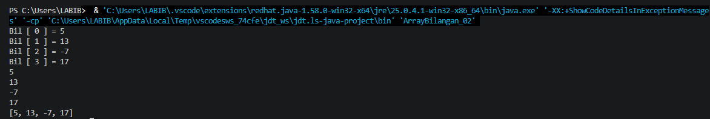
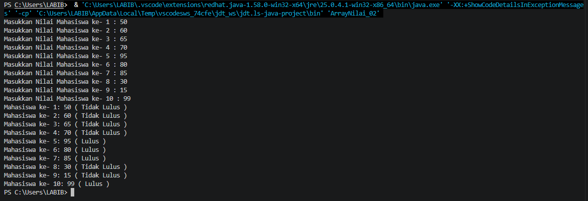
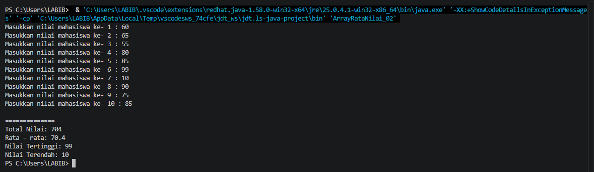
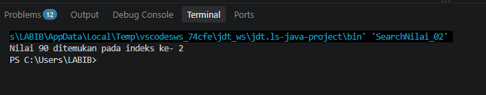
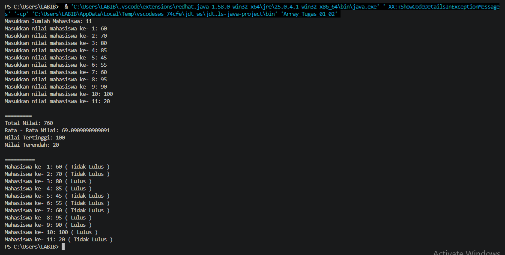
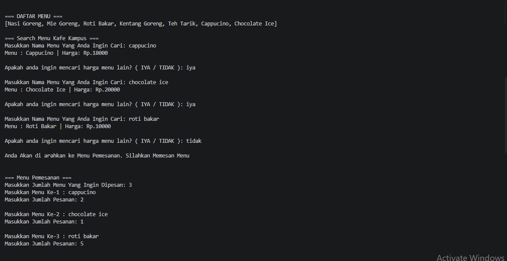
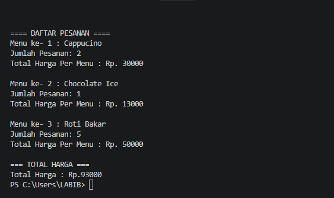

# JOBSHEET 9 WEEK 12 - Array 1 Dimensi

**Identitas Mahasiswa:**
* **Nama:** [ Achmad Labib Zainullah ]
* **NIM:** [ 264107020149 ]
* **Kelas / No. Presensi:** [ TI - 1D / 02 ]

---

## 1: TUJUAN PRAKTIKUM

Berikut adalah tujuan pelaksanaan praktikum pada bab ini:

 * Mahasiswa mampu memahami konsep array 1 dimensi serta cara mendeklarasikan, menginisialisasi,
   dan mengakses elemennya dalam bahasa pemrograman Java.
 * Mahasiswa mampu membuat program yang memanfaatkan array 1 dimensi untuk menyimpan dan
   mengolah data, termasuk menggunakan perulangan for dan foreach.
 * Mahasiswa mampu menerapkan operasi aritmatika pada elemen array, seperti menghitung total,
   rata-rata, nilai tertinggi, dan nilai terendah.
 * Mahasiswa mampu menerapkan algoritma pencarian (searching) dan pengurutan (sorting) sederhana
   pada array 1 dimensi.
 * Mahasiswa mampu menerapkan array 1 dimensi untuk menyelesaikan studi kasus yang relevan
   dengan kehidupan kampus dan sehari-hari.


---

## 2: PRAKTIKUM

### 2.1 Percobaan 1:  Deklarasi, Inisialisasi, Mengisi, dan Menampilkan Elemen Array

#### 2.1.1 Kode Program Java
```java

import java.util.Scanner;
import  java.util.Arrays;

public class ArrayBilangan_02 {

    public static void main(String[] args) {
        
        int[] bil = new int[4];

        bil [0] = 5;
        bil [1] = 13;
        bil [2] = -7;
        bil [3] = 17;

        for (int i = 0; i < bil.length; i++) {
            System.out.println("Bil [ " + i + " ] = " + bil[i]);
        }

        for (int nilai : bil) {
            System.out.println(nilai);
        }

        System.out.println(Arrays.toString(bil));
    }
}
```

#### 2.1.2 Hasil Running / Screenshot Output
Berikut adalah contoh tampilan *output* setelah program dijalankan:



#### 2.1.3 Jawaban Pertanyaan / Pertanyaan Refleksi
* **Pertanyaan 1:** Jika isi masing-masing elemen array bil diubah dengan angka 5.0, 12867, 7.5, 2000000, apa yang
terjadi? Mengapa bisa demikian?
    * **Jawab:** Akan terjadi error pada program karena deklarasi variabel `bil` menggunakan int maka tidak bisa menggunakan angka yang
      menggunakan koma
      
* **Pertanyaan 2:** Modifikasi kode program di atas dengan melakukan inisialisasi elemen array sekaligus pada saat
deklarasi array (tanpa new int[4] dan pengisian satu per satu).
	* **Jawab:** karakter `*` yang dihasilkan adalah 4 buah karakter. karena kondisi mengisyaratkan bahwa i kurang dari n. jika nilai
      inisiasi pertamanya adalah 1 maka yang akan muncul adalah 1 sampai 4 atau 4 buah karakater saja yang akan muncul

* **Setelah Modifikasi Menjadi Bilangan Ganjil Positif Saja**
```java

import java.util.Scanner;
import  java.util.Arrays;

public class ArrayBilangan_02 {

    public static void main(String[] args) {
        
        int[] bil = {5, 13, -7, 17};

        for (int i = 0; i < bil.length; i++) {
            System.out.println("Bil [ " + i + " ] = " + bil[i]);
        } 

        for (int nilai : bil) {
            System.out.println(nilai);
        }

        System.out.println(Arrays.toString(bil));
    }
}
```

* **Pertanyaan 3:** Ubah statement penampilan pada langkah ke-4 menjadi seperti berikut: System.out.println("bil[" + i
+ "] = " + bil[i] + ", double = " + (bil[i] * 2)); Apa keluaran dari program? Jelaskan maksud dari statement
tersebut.
	* **Jawab:** Statment tersebut bertujuan untuk menampilkan nilai nilai yang ada di setiap indeks Array untuk di kali dua.
	dan menampilkannya dengan output double sama dengan nilai setiap indeks di kali dua

* **Setelah Modifikasi Menjadi Bilangan Ganjil Positif Saja**
```java

import java.util.Scanner;
import  java.util.Arrays;

public class ArrayBilangan_02 {

    public static void main(String[] args) {
        
        int[] bil = {5, 13, -7, 17};

        for (int i = 0; i < bil.length; i++) {
            System.out.println("Bil [ " + i + " ] = " + bil[i] + " | Double = " + (bil[i] * 2));
        } 

        for (int nilai : bil) {
            System.out.println(nilai);
        }

        System.out.println(Arrays.toString(bil));
    }
}

```

* **Pertanyaan 4:** Jika kondisi pada statement for-loop di atas diubah menjadi i <= 4, apa keluaran dari program?
Mengapa demikian?
	* **Jawab:**  akan terjadi error karena jika kondisi for-loop di ubah menjadi `i <= 4` akan memerintahkan program atau Array
	mengakses indeks 4, tapi program di atas hanya memiliki 4 indeks yang di mulai dari 0 ( 0 sampai 3 ), maka dari itu indeks 4
	tidak ada yang bisa di tampilkan atau di akses oleh program yang menyebabkan error

* **Pertanyaan 5:**  Apa perbedaan antara menampilkan array menggunakan for loop, foreach loop, dan Arrays.toString()
pada langkah ke-5? Kapan sebaiknya masing-masing digunakan?
	* **Jawab:**
 * For loop : Tampilannya bebas bisa diatur sesuai kebutuhan. Gunakan ketika membutuhkan posisi (indeks) dan ingin memanipulasi isi Array
 * For each : Tampilannya Bebas diatur per baris atau elemen. Gunakan ketika hanya perlu membaca atau memproses semua nilai pada Array
 * Array.toString :  Tampilannya baku dalam satu baris. Gunakan untuk mengecek isi dalam Array secara cepat dan tidak rumit
  

---

### 2.2 Percobaan 2: Studi Kasus SIAKAD — Input Nilai Mahasiswa dan Status Kelulusan

Pada Sistem Informasi Akademik (SIAKAD), dosen perlu menginput nilai akhir mahasiswa dan mengetahui
status kelulusan masing-masing mahasiswa secara cepat.

#### 2.2.1 Kode Program Java

```java

import java.util.Scanner;

public class ArrayNilai_02 {

    public static void main(String[] args) {
        
        int[] nilaiAkhir = new int[10];
        Scanner sc = new Scanner(System.in);

        for (int i = 0; i < nilaiAkhir.length; i++) {
            System.out.print("Masukkan Nilai Mahasiswa ke- " + (i + 1) + " : ");
            nilaiAkhir[i] = sc.nextInt();
        }

        for (int i = 0; i < nilaiAkhir.length; i++) {
            String status = (nilaiAkhir[i] > 70) ? "Lulus" : "Tidak Lulus";
            System.out.println("Mahasiswa ke- " + (i + 1) + ": " + nilaiAkhir[i] + " ( " + status + " )");
        }
    }
}

```

#### 2.2.2 Hasil Running / Screenshot Output
Berikut adalah contoh tampilan *output* setelah program dijalankan:



#### 2.2.3 Jawaban Pertanyaan / Pertanyaan Refleksi
* **Pertanyaan 1:** Apa yang dimaksud dengan kondisi i < nilaiAkhir.length pada perulangan di atas?
    * **Jawab:** Fungsi variabel `i` dan `j` digunakan untuk nilai inisiasi pertama pada setiap perulangan nya yaitu outer loop dan inner 	loop
      
* **Pertanyaan 2:** Modifikasi program agar hanya menampilkan nilai mahasiswa yang lulus saja (nilai > 70), tanpa
menampilkan yang tidak lulus. Jelaskan alur programnya!
    * **Jawab:** Outer loop akan berjalan 4 kali perulangan karena outerloop berjalan untuk menentukan berapa baris yang di input. 			sedangkan inner loop akan berjalan 7 kali setiap barisnya karena inner loop berjalan untuk menentukan berapa kolom yang di input 		setiap perulangan yang dilakukan oleh outer loop
 
* **Setelah Modifikasi Menjadi Bilangan Ganjil Positif Saja**
```java

import java.util.Scanner;

public class Star02 {

    public static void main(String[] args) {
        Scanner sc = new Scanner(System.in);
        System.out.print("Masukkan nilai n = ");
        int n = sc.nextInt();

        for (int i = 1; i <= n; i += 2) {
            System.out.print(i + " ");
        }
        System.out.println();
        sc.close();
    }
}
```
      
* **Pertanyaan 3:**  Ubah perulangan pada langkah ke-4 dan ke-5 dari for loop menjadi foreach loop. Apakah seluruh
bagian program dapat diubah menjadi foreach? Jelaskan bagian mana yang bisa dan tidak bisa,
beserta alasannya.
    * **Jawab:** Akan menghasilkan output yang tertukar yang harusnya output menghasilkan nilai baris ini malah menghasilkan nilai kolom 	ataupun sebaliknya. Output yang dihasilkan dari baris 3 dan kolom 6 adalah menghasilkan baris 6 dan setiap barisnya menghasilkan 3 		baris bintang
      
* **Pertanyaan 4:** Modifikasi program agar turut menghitung dan menampilkan jumlah mahasiswa yang lulus dan
jumlah mahasiswa yang tidak lulus di akhir program.
    * **Jawab:** output yang dihasilkan akan terus kesamping tidak menghasilkan baris karena setiap innerloop tidak ada perintah untuk 		mengganti baris ke baris yang ada di bawahnya

* **Setelah Modifikasi Menjadi Bilangan Ganjil Positif Saja**
```java

import java.util.Scanner;

public class Star02 {

    public static void main(String[] args) {
        Scanner sc = new Scanner(System.in);
        System.out.print("Masukkan nilai n = ");
        int n = sc.nextInt();

        for (int i = 1; i <= n; i += 2) {
            System.out.print(i + " ");
        }
        System.out.println();
        sc.close();
    }
}
```

 
### 2.3 Percobaan 3:Operasi Aritmatika pada Array — Total, Rata-rata, Nilai Tertinggi dan Terendah

Percobaan ini melanjutkan studi kasus SIAKAD untuk menghasilkan ringkasan nilai mahasiswa,
sebagaimana biasa ditampilkan pada rekap nilai akhir semester.

#### 2.3.1 Kode Program Java

```java

import java.util.Scanner;

public class ArrayRataNilai_02 {

    public static void main(String[] args) {
        
        Scanner sc = new Scanner(System.in);

        int[] nilaiMhs = new int[10];
        int total = 0;
        double rata2 = 0;

        for (int i = 0; i < nilaiMhs.length; i++) {
            System.out.print("Masukkan nilai mahasiswa ke- " + (i + 1) + " : ");
            nilaiMhs[i] = sc.nextInt();
            total += nilaiMhs[i];
        }

        System.out.println();
        System.out.println("==============");

        rata2 = (double) total / nilaiMhs.length;
        System.out.println("Total Nilai: " + total);
        System.out.println("Rata - rata: " + rata2);

        int tertinggi = nilaiMhs[0];
        int terendah = nilaiMhs[0];

        for (int i = 1; i < nilaiMhs.length; i++) {
            if (nilaiMhs[i] > tertinggi) tertinggi = nilaiMhs[i];
            if (nilaiMhs[i] < terendah) terendah = nilaiMhs[i];
        }

        System.out.println("Nilai Tertinggi: " + tertinggi);
        System.out.println("Nilai Terendah: " + terendah);
    }
}

```

#### 2.3.2 Hasil Running / Screenshot Output
Berikut adalah contoh tampilan *output* setelah program dijalankan:



#### 2.3.3 Jawaban Pertanyaan / Pertanyaan Refleksi
* **Pertanyaan 1:** Modifikasi kode program di atas agar dapat menampilkan banyaknya mahasiswa yang lulus, yaitu
mahasiswa yang memiliki nilai lebih besar dari 70 (> 70).
	 * **Jawab:** Ketidaksesuaian output awal adalah semua bintang tercetak dalam satu baris dan terdapat perulangan tambahan yang 			menghasilkan baris kosong. Perbaikan yang diperlukan yaitu menambahkan System.out.println(); setelah inner loop agar setiap baris  ke 	baris baru serta mengubah inisialisasi outer loop dari i = 0 menjadi i = 1 agar jumlah baris sesuai dengan nilai n.
      
* **Pertanyaan 2:** Modifikasi program di atas sehingga program menerima jumlah elemen array berdasarkan input dari
pengguna (tidak selalu 10), lalu tetap dapat menghitung total, rata-rata, nilai tertinggi, dan nilai
terendah dengan benar.
    * **Jawab:**
     Nilai j harus diinisialisasi kembali ke 0 agar setiap baris dapat mencetak bintang sesuai dengan nilai i. Jika tidak di-reset, 		perulangan dalam tidak akan berjalan dengan benar karena nilai j sudah mencapai batas sebelumnya.

* **Pertanyaan 3:**  Mengapa pada perhitungan rata-rata digunakan (double) total / nilaiMhs.length, bukan langsung total
/ nilaiMhs.length? Jelaskan!
    * **Jawab:** Teknik ini digunakan agar kontrol penuh kapan perulangan harus berhenti dipindahkan ke dalam blok kode (menggunakan 		kombinasi if dan break). Hal ini sangat ideal untuk aplikasi kasir yang harus selalu siaga menerima pesanan pelanggan baru tanpa 		batasan jumlah putaran yang kaku.
 
### 2.4 Percobaan 4 : Pencarian (Searching) dan Pengurutan (Sorting) Sederhana

Percobaan ini menerapkan algoritma pencarian dan pengurutan sederhana pada data nilai mahasiswa,
dua kemampuan dasar yang banyak dipakai dalam pengolahan data nyata.

* **BAGIAN A — Linear Search** 

#### 2.4.1 Kode Program Java

```java

public class SearchNilai_02 {

    public static void main(String[] args) {
        
        int[] nilai = {78, 65, 90, 55, 88, 72};
        int key = 90;
        boolean ditemukan = false;

        for (int i = 0; i < nilai.length; i++) {
            if (nilai[i] == key) {
                System.out.println("Nilai " + key + " ditemukan pada indeks ke- " + i);
                ditemukan = true;
                break;
            }
        }

        if (!ditemukan) {
            System.out.println("Nilai " + key + " tidak ditemukan. ");
        }
    }
}

```

#### 2.4.2 Hasil Running / Screenshot Output


* **BAGIAN B — Bubble Sort** 

#### 2.4.1 Kode Program Java

```java

import java.util.Arrays;

public class SortNilai_02 {

    public static void main(String[] args) {
        
        int[] nilai = {78, 65, 90, 55, 88, 72};
        for (int i = 0; i < nilai.length; i++) {
            for (int j = 0; j < nilai.length - 1 - i; j++) {
                if (nilai[j] > nilai[j + 1]) {
                    int temp = nilai[j];
                    nilai[j] = nilai[j + 1];
                    nilai[j + 1] = temp;
                }
            }
        }

        System.out.println(Arrays.toString(nilai));
    }
}

```

#### 2.4.2 Hasil Running / Screenshot Output


* **Pertanyaan 1:** Jelaskan maksud dari statement break; pada kode program Bagian A di atas!
    * **Jawab:** Tercetak 6 karakter `*` karena nilai inisiasi pertama adalah nol dan kondisinya kurang dari sama dengan n maka yang akan
      muncul adalah 0 sampai 5 atau 6 buah karakter yang akan muncul

* **Pertanyaan 2:** Modifikasi kode program Bagian A sehingga program dapat menerima input berupa banyaknya
elemen array nilai, isi array, dan sebuah nilai (key) yang ingin dicari dari pengguna, lalu mencetak
indeks posisi elemen dari nilai (key) tersebut.
    * **Jawab:** Tercetak 6 karakter `*` karena nilai inisiasi pertama adalah nol dan kondisinya kurang dari sama dengan n maka yang akan
      muncul adalah 0 sampai 5 atau 6 buah karakter yang akan muncul

* **Setelah Modifikasi Menjadi Bilangan Ganjil Positif Saja**
```java

import java.util.Scanner;

public class Star02 {

    public static void main(String[] args) {
        Scanner sc = new Scanner(System.in);
        System.out.print("Masukkan nilai n = ");
        int n = sc.nextInt();

        for (int i = 1; i <= n; i += 2) {
            System.out.print(i + " ");
        }
        System.out.println();
        sc.close();
    }
}
```

* **Pertanyaan 3:** Modifikasi program Bagian A agar menampilkan pesan "Nilai yang dicari tidak ditemukan" dengan
format pesan yang lebih informatif apabila nilai yang dicari (key) tidak ada di dalam array.
    * **Jawab:** Tercetak 6 karakter `*` karena nilai inisiasi pertama adalah nol dan kondisinya kurang dari sama dengan n maka yang akan
      muncul adalah 0 sampai 5 atau 6 buah karakter yang akan muncul

* **Setelah Modifikasi Menjadi Bilangan Ganjil Positif Saja**
```java

import java.util.Scanner;

public class Star02 {

    public static void main(String[] args) {
        Scanner sc = new Scanner(System.in);
        System.out.print("Masukkan nilai n = ");
        int n = sc.nextInt();

        for (int i = 1; i <= n; i += 2) {
            System.out.print(i + " ");
        }
        System.out.println();
        sc.close();
    }
}
```

* **Pertanyaan 4:** Jelaskan langkah demi langkah cara kerja algoritma bubble sort pada Bagian B menggunakan data
ujicoba yang tersedia!
    * **Jawab:** Tercetak 6 karakter `*` karena nilai inisiasi pertama adalah nol dan kondisinya kurang dari sama dengan n maka yang akan
      muncul adalah 0 sampai 5 atau 6 buah karakter yang akan muncul

* **Pertanyaan 5:** Modifikasi program Bagian B agar mengurutkan array dari nilai terbesar ke terkecil (descending),
bukan dari terkecil ke terbesar.
    * **Jawab:** Tercetak 6 karakter `*` karena nilai inisiasi pertama adalah nol dan kondisinya kurang dari sama dengan n maka yang akan
      muncul adalah 0 sampai 5 atau 6 buah karakter yang akan muncul

* **Setelah Modifikasi Menjadi Bilangan Ganjil Positif Saja**
```java

import java.util.Scanner;

public class Star02 {

    public static void main(String[] args) {
        Scanner sc = new Scanner(System.in);
        System.out.print("Masukkan nilai n = ");
        int n = sc.nextInt();

        for (int i = 1; i <= n; i += 2) {
            System.out.print(i + " ");
        }
        System.out.println();
        sc.close();
    }
}
```
 
## 3: TUGAS MANDIRI

## Tugas No 01 Pengelolaan Nilai Mahasiswa

Buatlah program yang dapat menyimpan dan mengelola nilai mahasiswa (bilangan bulat). Program harus
menyediakan fitur untuk:
 *  Memasukkan banyaknya nilai mahasiswa yang akan diinput.
 *  Memasukkan setiap nilai mahasiswa satu per satu.
 *  Menghitung nilai rata-rata dari seluruh nilai yang dimasukkan.
 *  Menampilkan nilai tertinggi dan nilai terendah.
 *  Menampilkan semua nilai yang telah dimasukkan, beserta status kelulusannya (LULUS / TIDAK LULUS).


## Tugas No 02 Aplikasi Pemesanan Kafe Kampus

Buat program yang dapat mengelola pemesanan makanan dan minuman di kafe kampus. Program
menyediakan daftar menu yang sudah ditentukan, memungkinkan pengguna memilih menu melalui fitur
pencarian, mencatat pesanan, serta menghitung total biaya.


### 3.1 Implementasi Kode Tugas

* **Kode Program No 01**

```java

import java.util.Scanner;

public class Array_Tugas_01_02 {

    public static void main(String[] args) {
        
        Scanner sc = new Scanner(System.in);

        System.out.print("Masukkan Jumlah Mahasiswa: ");
        int jumlahMhs = sc.nextInt();
        int mahasiswa[] = new int[jumlahMhs];

        int total = 0;
        double rata2 = 0;

        for (int i = 0; i < mahasiswa.length; i++) {
            System.out.print("Masukkan nilai mahasiswa ke- " + (i + 1) + ": ");
            mahasiswa[i] = sc.nextInt();
            total += mahasiswa[i];
        }

        System.out.println();
        System.out.println("=========");

        rata2 = (double) total /  jumlahMhs;
        System.out.println("Total Nilai: " + total);
        System.out.println("Rata - Rata Nilai: " + rata2);

        int tertinggi = mahasiswa[0];
        int terendah = mahasiswa[0];

        for (int i = 0; i < jumlahMhs; i++) {
            if (mahasiswa[i] > tertinggi) tertinggi = mahasiswa[i];
            if (mahasiswa[i] < terendah) terendah = mahasiswa[i];
        }

        System.out.println("Nilai Tertinggi: " + tertinggi);
        System.out.println("Nilai Terendah: " + terendah);

        System.out.println();
        System.out.println("==========");

        for (int i = 0; i < jumlahMhs; i++) {
            String status = (mahasiswa[i] > 70) ? "Lulus" : "Tidak Lulus";
            System.out.println("Mahasiswa ke- " + (i + 1) + ": " + mahasiswa[i] + " ( " + status + " )");
        }
    }
}
  
```

* **Kode Program No 02**

```java

import java.util.Scanner;
import java.util.Arrays;;

public class Array_Tugas_02_02 {

    public static void main(String[] args) {
        
        Scanner sc = new Scanner(System.in);

        String[] menu = {"Nasi Goreng", "Mie Goreng", "Roti Bakar", "Kentang Goreng", "Teh Tarik", "Cappucino", "Chocolate Ice"};
        int[] harga = {15000, 13000, 10000, 12000, 8000, 18000, 20000};

        System.out.println();
        System.out.println("=== DAFTAR MENU ===");
        
        System.out.println(Arrays.toString(menu));

        System.out.println();

        String ulang;

        System.out.println("=== Search Menu Kafe Kampus ===");
        do {
            System.out.print("Masukkan Nama Menu Yang Anda Ingin Cari: ");
            String cari = sc.nextLine();

            boolean ditemukan = false;

            for (int i = 0; i < menu.length; i++) {

                if (menu[i].equalsIgnoreCase(cari)) {
                    System.out.println("Menu : " + menu[i] + " | " + "Harga: Rp." + harga[i]);

                    ditemukan = true;
                    break;
                }
            }

            if (!ditemukan) {
                System.out.println("Menu tidak ditemukan");
            }

            System.out.print("\nApakah anda ingin mencari harga menu lain? ( IYA / TIDAK ): ");
            ulang = sc.nextLine();
            if (ulang.equalsIgnoreCase("TIDAK")) {
                System.out.println();
                System.out.println("Anda Akan di arahkan ke Menu Pemesanan. Silahkan Memesan Menu ");
            }

            System.out.println();
        } while (ulang.equalsIgnoreCase("IYA"));

        System.out.println();

        System.out.println("=== Menu Pemesanan ===");
        System.out.print("Masukkan Jumlah Menu Yang Ingin Dipesan: ");
        int jumlahMenu = sc.nextInt();
        sc.nextLine();

        int totalHarga = 0;

        String daftarPesanan[] = new String[jumlahMenu];
        int jumlahPesanan[] = new int[jumlahMenu];
        int subtotalPesanan[] = new int[jumlahMenu];

        int jumlahDataPesanan = 0;

        for (int i = 0; i < jumlahMenu; i++) {
            System.out.print("Masukkan Menu Ke-" + (i + 1) + " : ");
            String pesan = sc.nextLine();

            boolean ditemukan = false;

            for (int j = 0; j < menu.length; j++) {

                if (menu[j].equalsIgnoreCase(pesan)) {
                    System.out.print    ("Masukkan Jumlah Pesanan: ");
                    int jumlah = sc.nextInt();
                    sc.nextLine();

                    daftarPesanan[jumlahDataPesanan] = menu[j];
                    jumlahPesanan[jumlahDataPesanan] = jumlah;
                    subtotalPesanan[jumlahDataPesanan] = harga[jumlahDataPesanan] * jumlah;

                    totalHarga += subtotalPesanan[jumlahDataPesanan];
                    jumlahDataPesanan++;
                    

                    ditemukan = true;
                    break;
                }
            }

            if (!ditemukan) {
                System.out.println("Menu Tidak Tersedia");
            }

            System.out.println();

        }

        System.out.println();
        System.out.println("==== DAFTAR PESANAN ====");

        for (int i = 0; i < jumlahDataPesanan; i++) {
            System.out.println("Menu ke- " + (i + 1) + " : " + daftarPesanan[i]);
            System.out.println("Jumlah Pesanan: " + jumlahPesanan[i]);
            System.out.println("Total Harga Per Menu : Rp. " + subtotalPesanan[i]);
            System.out.println();
        }

        System.out.println("=== TOTAL HARGA ===");
        System.out.println("Total Harga : Rp." + totalHarga);
        
    }
}

```


#### 3.2 Hasil Running / Screenshot Output
Berikut adalah contoh tampilan *output* setelah program dijalankan:

* **Hasil Kode Program Nomor 01**



* **Hasil Kode Program Nomor 02 Bagian 01**
  


* **Hasil Kode Program Nomor 02 Bagian 02**
  



## 4: KESIMPULAN

* **Kesimpulan**

Berdasarkan praktikum Jobsheet 9, dapat disimpulkan bahwa array 1 dimensi dalam Java digunakan untuk menyimpan dan mengolah sekumpulan data dengan tipe yang sama. Melalui praktikum ini, mahasiswa mempelajari cara membuat, mengisi, menampilkan, serta mengolah data menggunakan perulangan. Selain itu, array dapat digunakan untuk menghitung total, rata-rata, nilai tertinggi dan terendah, melakukan pencarian (*searching*), serta pengurutan (*sorting*). Dengan demikian, penggunaan array dapat mempermudah pengelolaan data dan membantu menyelesaikan berbagai permasalahan dalam pemrograman.
