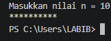
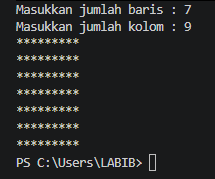
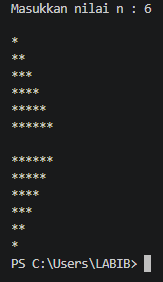
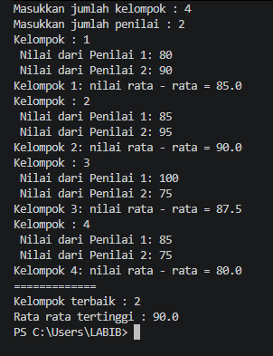
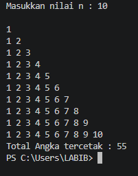
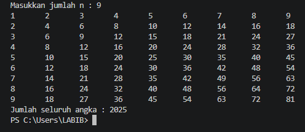
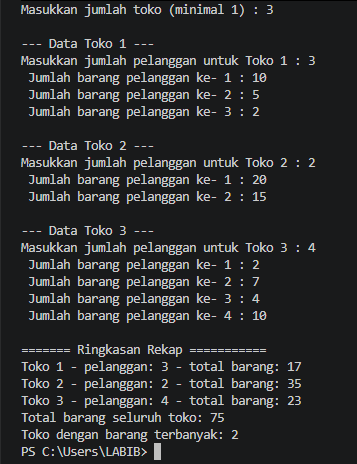

# JOBSHEET 9 WEEK 12 - Array 1 Dimensi

**Identitas Mahasiswa:**
* **Nama:** [ Achmad Labib Zainullah ]
* **NIM:** [ 264107020149 ]
* **Kelas / No. Presensi:** [ TI - 1D / 02 ]

---

## 1: TUJUAN PRAKTIKUM

Berikut adalah tujuan pelaksanaan praktikum pada bab ini:

 * Mahasiswa mampu memahami konsep array 1 dimensi serta cara mendeklarasikan, menginisialisasi,
   dan mengakses elemennya dalam bahasa pemrograman Java.
 * Mahasiswa mampu membuat program yang memanfaatkan array 1 dimensi untuk menyimpan dan
   mengolah data, termasuk menggunakan perulangan for dan foreach.
 * Mahasiswa mampu menerapkan operasi aritmatika pada elemen array, seperti menghitung total,
   rata-rata, nilai tertinggi, dan nilai terendah.
 * Mahasiswa mampu menerapkan algoritma pencarian (searching) dan pengurutan (sorting) sederhana
   pada array 1 dimensi.
 * Mahasiswa mampu menerapkan array 1 dimensi untuk menyelesaikan studi kasus yang relevan
   dengan kehidupan kampus dan sehari-hari.


---

## 2: PRAKTIKUM

### 2.1 Percobaan 1:  Deklarasi, Inisialisasi, Mengisi, dan Menampilkan Elemen Array

#### 2.1.1 Kode Program Java
```java

import java.util.Scanner;
import  java.util.Arrays;

public class ArrayBilangan_02 {

    public static void main(String[] args) {
        
        int[] bil = new int[4];

        bil [0] = 5;
        bil [1] = 13;
        bil [2] = -7;
        bil [3] = 17;

        for (int i = 0; i < bil.length; i++) {
            System.out.println("Bil [ " + i + " ] = " + bil[i]);
        }

        for (int nilai : bil) {
            System.out.println(nilai);
        }

        System.out.println(Arrays.toString(bil));
    }
}
```

#### 2.1.2 Hasil Running / Screenshot Output
Berikut adalah contoh tampilan *output* setelah program dijalankan:



#### 2.1.3 Jawaban Pertanyaan / Pertanyaan Refleksi
* **Pertanyaan 1:** Jika isi masing-masing elemen array bil diubah dengan angka 5.0, 12867, 7.5, 2000000, apa yang
terjadi? Mengapa bisa demikian?
    * **Jawab:** Tercetak 6 karakter `*` karena nilai inisiasi pertama adalah nol dan kondisinya kurang dari sama dengan n maka yang akan
      muncul adalah 0 sampai 5 atau 6 buah karakter yang akan muncul
      
* **Pertanyaan 2:** Modifikasi kode program di atas dengan melakukan inisialisasi elemen array sekaligus pada saat
deklarasi array (tanpa new int[4] dan pengisian satu per satu).
	* **Jawab:** karakter `*` yang dihasilkan adalah 4 buah karakter. karena kondisi mengisyaratkan bahwa i kurang dari n. jika nilai
      inisiasi pertamanya adalah 1 maka yang akan muncul adalah 1 sampai 4 atau 4 buah karakater saja yang akan muncul

* **Setelah Modifikasi Menjadi Bilangan Ganjil Positif Saja**
```java

import java.util.Scanner;

public class Star02 {

    public static void main(String[] args) {
        Scanner sc = new Scanner(System.in);
        System.out.print("Masukkan nilai n = ");
        int n = sc.nextInt();

        for (int i = 1; i <= n; i += 2) {
            System.out.print(i + " ");
        }
        System.out.println();
        sc.close();
    }
}
```

* **Pertanyaan 3:** Ubah statement penampilan pada langkah ke-4 menjadi seperti berikut: System.out.println("bil[" + i
+ "] = " + bil[i] + ", double = " + (bil[i] * 2)); Apa keluaran dari program? Jelaskan maksud dari statement
tersebut.
	* **Jawab:** karakter `*` yang dihasilkan adalah 4 buah karakter. karena kondisi mengisyaratkan bahwa i kurang dari n. jika nilai
      inisiasi pertamanya adalah 1 maka yang akan muncul adalah 1 sampai 4 atau 4 buah karakater saja yang akan muncul

* **Setelah Modifikasi Menjadi Bilangan Ganjil Positif Saja**
```java

import java.util.Scanner;

public class Star02 {

    public static void main(String[] args) {
        Scanner sc = new Scanner(System.in);
        System.out.print("Masukkan nilai n = ");
        int n = sc.nextInt();

        for (int i = 1; i <= n; i += 2) {
            System.out.print(i + " ");
        }
        System.out.println();
        sc.close();
    }
}
```

* **Pertanyaan 4:** JJika kondisi pada statement for-loop di atas diubah menjadi i <= 4, apa keluaran dari program?
Mengapa demikian?
	* **Jawab:**  Karena perubahan dari `i++` menjadi `i--` mengakibatkan kondisi selalu bernilai true. maka dari itu output terus 			dihasilkan dan perulangan tidak pernah akan berhenti karena kondisi tidak akan menghasilkan nilai false

* **Pertanyaan 5:**  Apa perbedaan antara menampilkan array menggunakan for loop, foreach loop, dan Arrays.toString()
pada langkah ke-5? Kapan sebaiknya masing-masing digunakan?
	* **Jawab:**  Karena perubahan dari `i++` menjadi `i--` mengakibatkan kondisi selalu bernilai true. maka dari itu output terus 			dihasilkan dan perulangan tidak pernah akan berhenti karena kondisi tidak akan menghasilkan nilai false
  

---

### 2.2 Percobaan 2: Studi Kasus SIAKAD — Input Nilai Mahasiswa dan Status Kelulusan

Pada Sistem Informasi Akademik (SIAKAD), dosen perlu menginput nilai akhir mahasiswa dan mengetahui
status kelulusan masing-masing mahasiswa secara cepat.

#### 2.2.1 Kode Program Java

```java

import java.util.Scanner;

public class ArrayNilai_02 {

    public static void main(String[] args) {
        
        int[] nilaiAkhir = new int[10];
        Scanner sc = new Scanner(System.in);

        for (int i = 0; i < nilaiAkhir.length; i++) {
            System.out.print("Masukkan Nilai Mahasiswa ke- " + (i + 1) + " : ");
            nilaiAkhir[i] = sc.nextInt();
        }

        for (int i = 0; i < nilaiAkhir.length; i++) {
            String status = (nilaiAkhir[i] > 70) ? "Lulus" : "Tidak Lulus";
            System.out.println("Mahasiswa ke- " + (i + 1) + ": " + nilaiAkhir[i] + " ( " + status + " )");
        }
    }
}

```

#### 2.2.2 Hasil Running / Screenshot Output
Berikut adalah contoh tampilan *output* setelah program dijalankan:



#### 2.2.3 Jawaban Pertanyaan / Pertanyaan Refleksi
* **Pertanyaan 1:** Apa yang dimaksud dengan kondisi i < nilaiAkhir.length pada perulangan di atas?
    * **Jawab:** Fungsi variabel `i` dan `j` digunakan untuk nilai inisiasi pertama pada setiap perulangan nya yaitu outer loop dan inner 	loop
      
* **Pertanyaan 2:** Modifikasi program agar hanya menampilkan nilai mahasiswa yang lulus saja (nilai > 70), tanpa
menampilkan yang tidak lulus. Jelaskan alur programnya!
    * **Jawab:** Outer loop akan berjalan 4 kali perulangan karena outerloop berjalan untuk menentukan berapa baris yang di input. 			sedangkan inner loop akan berjalan 7 kali setiap barisnya karena inner loop berjalan untuk menentukan berapa kolom yang di input 		setiap perulangan yang dilakukan oleh outer loop
 
* **Setelah Modifikasi Menjadi Bilangan Ganjil Positif Saja**
```java

import java.util.Scanner;

public class Star02 {

    public static void main(String[] args) {
        Scanner sc = new Scanner(System.in);
        System.out.print("Masukkan nilai n = ");
        int n = sc.nextInt();

        for (int i = 1; i <= n; i += 2) {
            System.out.print(i + " ");
        }
        System.out.println();
        sc.close();
    }
}
```
      
* **Pertanyaan 3:**  Ubah perulangan pada langkah ke-4 dan ke-5 dari for loop menjadi foreach loop. Apakah seluruh
bagian program dapat diubah menjadi foreach? Jelaskan bagian mana yang bisa dan tidak bisa,
beserta alasannya.
    * **Jawab:** Akan menghasilkan output yang tertukar yang harusnya output menghasilkan nilai baris ini malah menghasilkan nilai kolom 	ataupun sebaliknya. Output yang dihasilkan dari baris 3 dan kolom 6 adalah menghasilkan baris 6 dan setiap barisnya menghasilkan 3 		baris bintang
      
* **Pertanyaan 4:** Modifikasi program agar turut menghitung dan menampilkan jumlah mahasiswa yang lulus dan
jumlah mahasiswa yang tidak lulus di akhir program.
    * **Jawab:** output yang dihasilkan akan terus kesamping tidak menghasilkan baris karena setiap innerloop tidak ada perintah untuk 		mengganti baris ke baris yang ada di bawahnya 

 
### 2.3 Percobaan 3:Operasi Aritmatika pada Array — Total, Rata-rata, Nilai Tertinggi dan Terendah

Percobaan ini melanjutkan studi kasus SIAKAD untuk menghasilkan ringkasan nilai mahasiswa,
sebagaimana biasa ditampilkan pada rekap nilai akhir semester.

#### 2.3.1 Kode Program Java

```java

import java.util.Scanner;

public class ArrayRataNilai_02 {

    public static void main(String[] args) {
        
        Scanner sc = new Scanner(System.in);

        int[] nilaiMhs = new int[10];
        int total = 0;
        double rata2 = 0;

        for (int i = 0; i < nilaiMhs.length; i++) {
            System.out.print("Masukkan nilai mahasiswa ke- " + (i + 1) + " : ");
            nilaiMhs[i] = sc.nextInt();
            total += nilaiMhs[i];
        }

        System.out.println();
        System.out.println("==============");

        rata2 = (double) total / nilaiMhs.length;
        System.out.println("Total Nilai: " + total);
        System.out.println("Rata - rata: " + rata2);

        int tertinggi = nilaiMhs[0];
        int terendah = nilaiMhs[0];

        for (int i = 1; i < nilaiMhs.length; i++) {
            if (nilaiMhs[i] > tertinggi) tertinggi = nilaiMhs[i];
            if (nilaiMhs[i] < terendah) terendah = nilaiMhs[i];
        }

        System.out.println("Nilai Tertinggi: " + tertinggi);
        System.out.println("Nilai Terendah: " + terendah);
    }
}

```

#### 2.3.2 Hasil Running / Screenshot Output
Berikut adalah contoh tampilan *output* setelah program dijalankan:



#### 2.3.3 Jawaban Pertanyaan / Pertanyaan Refleksi
* **Pertanyaan 1:**  Sebutkan ketidaksesuaian output awal dan minimal dua perbaikan yang diperlukan untuk
menghasilkan pola segitiga bertingkat.
    * **Jawab:** Ketidaksesuaian output awal adalah semua bintang tercetak dalam satu baris dan terdapat perulangan tambahan yang menghasilkan baris kosong. Perbaikan yang diperlukan yaitu menambahkan System.out.println(); setelah inner loop agar setiap baris berpindah ke baris baru serta mengubah inisialisasi outer loop dari i = 0 menjadi i = 1 agar jumlah baris sesuai dengan nilai n.
      
* **Pertanyaan 2:** Jelaskan peran variabel i dan j. Mengapa nilai j harus diinisialisasi kembali ke 0 pada
setiap iterasi outer loop? Apa yang terjadi jika j tidak di-reset?
    * **Jawab:**
     Nilai j harus diinisialisasi kembali ke 0 agar setiap baris dapat mencetak bintang sesuai dengan nilai i. Jika tidak di-reset, perulangan dalam tidak akan berjalan dengan benar karena nilai j sudah mencapai batas sebelumnya.

* **Pertanyaan 3:**  Jelaskan perubahan inisialisasi, kondisi, dan perubahan nilai (update) pada outer loop
yang diperlukan untuk membentuk segitiga terbalik.
    * **Jawab:** Teknik ini digunakan agar kontrol penuh kapan perulangan harus berhenti dipindahkan ke dalam blok kode (menggunakan kombinasi if dan break). Hal ini sangat ideal untuk aplikasi kasir yang harus selalu siaga menerima pesanan pelanggan baru tanpa batasan jumlah putaran yang kaku.
    * Ini Adalah Kode Program Segitiga Terbalik
      
```java
 i = n;
        while (i > 0) {
            int j = 0;
            while (j < i) {
                System.out.print("*");
                j++;
            }
            System.out.println();
            i--;
        }
```
Untuk membuat segitiga terbalik, inisialisasi variabel i diubah menjadi n, kondisi perulangan menjadi i > 0, dan nilai i dikurangi menggunakan i-- setiap kali perulangan selesai

### 2.4 Percobaan 4: Studi Kasus Nilai Tugas Proyek Kelompok

Dalam penilaian proyek kelompok, setiap kelompok memperoleh nilai dari sejumlah penilai.
Program menerima jumlah kelompok dan jumlah penilai yang sama untuk setiap kelompok,
kemudian menghitung rata-rata nilai tiap kelompok dan menentukan kelompok dengan ratarata tertinggi. Kasus ini diselesaikan dengan nested loop tanpa perlu menyimpan seluruh nilai:
WHILE (luar) untuk kelompok, FOR (tengah) untuk penilai, dan DO-WHILE (dalam) untuk
mengulang input nilai yang tidak valid.

#### 2.4.1 Kode Program Java

```java

import java.util.Scanner;

public class NilaiKelompok02 {

    public static void main(String[] args) {
        Scanner sc = new Scanner(System.in);
        System.out.print("Masukkan jumlah kelompok : ");
        int jumlahKelompok = sc.nextInt();
        System.out.print("Masukkan jumlah penilai : ");
        int jumlahPenilai = sc.nextInt();

        if (jumlahKelompok <= 0 || jumlahKelompok <= 0) {
            System.out.println("Jumlah kelompok dan penilai harus lebih dari 0");
        } else {
            int nomorKelompok = 1;
            double rataTertinggi = -1;
            int kelompokTerbaik = 0;

            while (nomorKelompok <= jumlahKelompok) {
                System.out.println("Kelompok : " + nomorKelompok);
                double totalNilai = 0;

                for (int i = 1; i <= jumlahPenilai; i++) {
                    int nilai;
                    do {
                        System.out.print(" Nilai dari Penilai " + i + ": ");
                        nilai = sc.nextInt();
                        if (nilai < 0 || nilai > 100) {
                            System.out.println(" Nilai harus bernilai antara 0 sampai 100. Ulangi input");
                        }
                    } while (nilai < 0 || nilai > 100);
                    totalNilai += nilai;
                }

                double rataNilai = totalNilai / jumlahPenilai;
                System.out.println("Kelompok " + nomorKelompok + ": nilai rata - rata = " + rataNilai);

                if (rataNilai > rataTertinggi) {
                   rataTertinggi = rataNilai;
                   kelompokTerbaik = nomorKelompok;
                }
                nomorKelompok++;
            }
                System.out.println("=============");
                System.out.println("Kelompok terbaik : " + kelompokTerbaik);
                System.out.println("Rata rata tertinggi : " + rataTertinggi);
        }
        sc.close();
    }
}

```

#### 2.4.2 Hasil Running / Screenshot Output
Berikut adalah contoh tampilan *output* setelah program dijalankan:



#### 2.4.3 Jawaban Pertanyaan / Pertanyaan Refleksi
* **Pertanyaan 1:**  Mengapa totalNilai perlu di-reset di dalam outer loop, tetapi rataTertinggi tidak
boleh di-reset pada setiap kelompok?
    * **Jawab:** `totalNilai` perlu di-reset menjadi 0 pada setiap kelompok agar nilai dari kelompok sebelumnya tidak tercampur dengan kelompok berikutnya. Sedangkan `rataTertinggi` tidak boleh di-reset karena digunakan untuk menyimpan dan membandingkan rata-rata tertinggi dari seluruh kelompok yang telah diproses.
      
* **Pertanyaan 2:** Untuk 3 kelompok dan 2 penilai (tanpa input yang salah), berapa kali badan perulangan
FOR dijalankan secara keseluruhan?
    * **Jawab:**
     Badan perulangan FOR dijalankan sebanyak 6 kali. Hal ini karena terdapat 3 kelompok dan setiap kelompok dinilai oleh 2 penilai

* **Pertanyaan 3:**  Apa yang terjadi jika totalNilai dideklarasikan sebagai int dan rata-rata dihitung
menggunakan pembagian dua bilangan bulat? Berikan contoh nilai.
    * **Jawab:** Jika menggunakan tipe data int, hasil pembagian bilangan bulat akan menghilangkan angka di belakang koma. Contohnya, jika total nilai adalah 171 dan jumlah penilai adalah 2, hasil pembagian menjadi `85`, bukan `85,5`.

* **Pertanyaan 4:**  Mengapa rataTertinggi diberi nilai awal -1, bukan 0? Berikan contoh input yang
membuat hasil salah apabila nilai awalnya 0.
    * **Jawab:** Karena nilai awal -1 memastikan bahwa kelompok pertama tetap dapat tercatat sebagai kelompok terbaik, meskipun semua nilai yang diberikan adalah 0. Jika nilai awalnya 0 dan seluruh kelompok mendapatkan rata-rata 0, kondisi `rataNilai > rataTertinggi` tidak akan terpenuhi sehingga kelompok terbaik yang dihasilakan adalah `kelompok : 0`.

* **Pertanyaan 5:**   Program ini memiliki tiga tingkat perulangan. Sebutkan masing-masing jenis perulangan
beserta perannya.
    * **Jawab:**
    * While : Untuk menentukan setiap nomor kelompok yang perlu diberi input secara bergantian
    * For : Untuk menentukan jumlah penilai yang harus menginput dan menjumlahkan nilai dari setiap kelompoknya secara bergantian
    * Do - While : Digunakan untuk input dan menjumlahkan nilai dan digunakan untuk mengulang input nilai apabila nilai yang dimasukkan tidak sesuai dengan rentang 0 sampai 100.
    
## 3: TUGAS MANDIRI
Kerjakan tugas berikut secara mandiri. Gunakan nested loop, struktur pemilihan jika
diperlukan, dan cukup gunakan variabel biasa (variabel penampung dan penghitung) untuk
menyimpan hasil perhitungan. Buat file terpisah untuk setiap tugas. Commit dan push seluruh
file ke repository daspro-jobsheet8 di GitHub.

* **Tugas No 01 Pola Bilangan Bertingkat** Buat program untuk mencetak pola bilangan 1 sampai nomor baris. Masukkan bilangan bulat
n (n minimal 1). Pada baris pertama tercetak 1, pada baris kedua 1 2, dan seterusnya sampai
baris ke-n. Setelah pola selesai, tampilkan total banyaknya angka yang telah dicetak. Simpan
dengan nama file: Tugas1NoAbsen.java.
Contoh untuk n = 5:


* **Tugas No 02 Tabel Perkalian** Buat program untuk menampilkan tabel perkalian berukuran n × n menggunakan nested FOR
atau WHILE. Nilai n minimal 3. Setiap posisi menampilkan hasil perkalian nomor baris dan
nomor kolom. Atur spasi agar keluaran rapi, lalu tampilkan jumlah seluruh angka pada tabel.
Simpan program dengan nama file: Tugas2NoAbsen.java.


* **Tugas No 03 Rekap Penjualan Beberapa Toko** Sebuah pusat perbelanjaan memiliki beberapa toko. Setiap toko melayani sejumlah
pelanggan pada hari yang sama, dan setiap pelanggan membeli beberapa barang. Program
meminta jumlah toko, kemudian jumlah pelanggan pada masing-masing toko, dan jumlah
barang yang dibeli setiap pelanggan. Hitung dan tampilkan total pelanggan serta total barang
per toko, total barang seluruh toko, dan nomor toko dengan jumlah barang terbanyak. Jika
terdapat nilai tertinggi yang sama, tampilkan toko dengan nomor paling kecil. Simpan
program dengan nama file: Tugas3NoAbsen.java.

Ketentuan: jumlah toko minimal 1; jumlah pelanggan dan jumlah barang setiap pelanggan
boleh 0, tetapi tidak boleh negatif. Gunakan perulangan bersarang; data tidak perlu disimpan
satu per satu, cukup diakumulasikan ke variabel total.


### 3.1 Implementasi Kode Tugas

* **Kode Program No 01**

```java

import java.util.Scanner;

public class Tugas1_02 {

    public static void main(String[] args) {
        Scanner sc = new Scanner(System.in);
        System.out.print("Masukkan nilai n : ");
        int n = sc.nextInt();

        int i = 0;
        int total = 0;
        while (i <= n) {
            int j = 0;
            int k = 1;
            while (j < i) {
                System.out.print(k + " ");
                j++;
                k++;
            }
        total += i;
        i++;
        System.out.println();
        }
        System.out.println("Total Angka tercetak : " + total);
        sc.close();
    }
}
  
```

* **Kode Program No 02**

```java

import java.util.Scanner;

public class Tugas2_02 {

    public static void main(String[] args) {
        Scanner sc = new Scanner(System.in);
        System.out.print("Masukkan jumlah n : ");
        int n = sc.nextInt();
        int total = 0;
        int a = 0;

        for (int i = 1; i <= n; i++) {
            for (int j = 1; j <= n; j++) {
                System.out.print(i * j + "\t");
                a = i * j;
                total += a;
            }
            System.out.println();
        }
        System.out.println("Jumlah seluruh angka : " + total);
        sc.close();
    }
}

```


* **Kode Program No 03**

```java

import java.util.Scanner;

public class Tugas3_02 {

    public static void main(String[] args) {
        Scanner labib = new Scanner(System.in);
        
        int jumlahToko;
        do {
            System.out.print("Masukkan jumlah toko (minimal 1) : ");
            jumlahToko = labib.nextInt();
            if (jumlahToko < 1) {
                System.out.println("Jumlah toko tidak boleh kurang dari 1. Ulangi ");
            }
        } while (jumlahToko < 1);

        int totalBarangSeluruhToko = 0;
        int tokoTerbanyak = 0;
        int barangTerbanyak = -1;

        String ringkasanPerToko = "";

        for (int i = 1; i <= jumlahToko; i++) {
            System.out.println("\n--- Data Toko " + i + " ---");
            int jumlahPelanggan;
            do {
                System.out.print("Masukkan jumlah pelanggan untuk Toko " + i + " : ");
                jumlahPelanggan = labib.nextInt();
                if (jumlahPelanggan < 0) {
                    System.out.println("Jumlah pelanggan tidak boleh negatif. Ulangi");
                }
            } while (jumlahPelanggan < 0);

            int totalBarangTokoIni = 0;

            for (int j = 1; j <= jumlahPelanggan; j++) {
                int jumlahBarang;
                do {
                    System.out.print(" Jumlah barang pelanggan ke- " + j + " : ");
                    jumlahBarang = labib.nextInt();
                    if (jumlahBarang < 0) {
                        System.out.println( " jumlah barang tidak boleh negatif. Ulangi");
                    }
                } while (jumlahBarang < 0);
                totalBarangTokoIni += jumlahBarang;
            }

            ringkasanPerToko += "Toko " + i + " - pelanggan: " + jumlahPelanggan + " - total barang: " + totalBarangTokoIni + "\n";
            totalBarangSeluruhToko += totalBarangTokoIni;

            if (totalBarangTokoIni > barangTerbanyak) {
                barangTerbanyak = totalBarangTokoIni;
                tokoTerbanyak = i;
            }
        }
            System.out.println("\n======= Ringkasan Rekap ===========");
            System.out.print(ringkasanPerToko);
            System.out.println("Total barang seluruh toko: " + totalBarangSeluruhToko);
            System.out.println("Toko dengan barang terbanyak: " + tokoTerbanyak);    
            labib.close();
    }
}


```
#### 3.2 Hasil Running / Screenshot Output
Berikut adalah contoh tampilan *output* setelah program dijalankan:

* **Hasil Kode Program Nomor 01**



* **Hasil Kode Program Nomor 02**
  


* **Hasil Kode Program Nomor 03**
  


## 4: KESIMPULAN

* **Kesimpulan**
Kesimpulan:
Berdasarkan Jobsheet 8, dapat disimpulkan bahwa perulangan bersarang (nested loop) merupakan perulangan di dalam perulangan yang digunakan untuk membuat pola dan menyelesaikan perhitungan secara berulang. Dengan memahami penggunaan FOR, WHILE, dan DO-WHILE, kita dapat membuat program yang lebih terstruktur, seperti pola bintang, tabel perkalian, serta pengolahan data nilai dan penjualan.


