# JOBSHEET 11 WEEK 13 - Array 2 Dimensi

**Identitas Mahasiswa:**
* **Nama:** [ Achmad Labib Zainullah ]
* **NIM:** [ 264107020149 ]
* **Kelas / No. Presensi:** [ TI - 1D / 02 ]

---

## 1: TUJUAN PRAKTIKUM

Berikut adalah tujuan pelaksanaan praktikum pada bab ini:

 * Mendeklarasikan, menginstansiasi, dan menginisialisasi array 2 dimensi dalam bahasa Java.
 * Mengakses dan mengisi elemen array 2 dimensi menggunakan indeks baris dan kolom.
 * Memproses array 2 dimensi dengan nested loop, baik for maupun foreach.
 * Membuat array 2 dimensi dengan panjang baris yang berbeda (*jagged array*).
 * Menghitung nilai rata-rata per baris dan per kolom pada studi kasus nyata.


---

## 2: PRAKTIKUM

### Percobaan 1: Deklarasi, Inisialisasi, dan Menampilkan Array 2 Dimensi

#### Kode Program Java
```java

public class Bioskop {

    public static void main(String[] args) {
        
        String[][] penonton = new String[4][2];

        penonton[0][0] = "Amin";
        penonton[0][1] = "Bena";
        penonton[1][0] = "Candra";
        penonton[1][1] = "Dela";
        penonton[2][0] = "Eka";
        penonton[2][1] = "Farhan";
        penonton[3][0] = "Gisel";

        System.out.println();
        System.out.printf("%s \t %s\n", penonton[0][0], penonton[0][1]);
        System.out.printf("%s \t %s\n", penonton[1][0], penonton[1][1]);
        System.out.printf("%s \t %s\n", penonton[2][0], penonton[2][1]);
        System.out.printf("%s \t %s\n", penonton[3][0], penonton[3][1]);
        System.out.println();
    }
}

```

#### Hasil Running / Screenshot Output
Berikut adalah contoh tampilan *output* setelah program dijalankan:

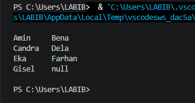

* **Pertanyaan 1:** Apakah pengisian elemen array harus dilakukan secara berurutan mulai dari indeks ke-0?
Jelaskan!
    * **Jawab:** Tidak, pengisian elemen array tidak harus dilakukan secara berurutan mulai dari indeks ke-0. Kamu bisa mengisi elemen
      pada indeks mana pun secara acak selama indeks tersebut masih berada dalam batas ukuran array yang telah dialokasikan.
 
* **Pertanyaan 2:** Mengapa terdapat null pada daftar nama penonton? Jelaskan dari sisi nilai default array
    * **Jawab:** Nilai null muncul karena saat kita membuat array bertipe data objek (seperti String) dengan ukuran tertentu, namun belum
      mengisi semua indeksnya sehingga ruang kosong tersebut otomatis di isi dengan defaultnya yaitu `null`
 
* **Pertanyaan 3:** Lengkapi pengisian pada langkah 3 jika ada elemen yang belum terisi, lalu jalankan
kembali program.
    * **Jawab:**
      Berikut adalah contoh tampilan *output* setelah program dijalankan:
      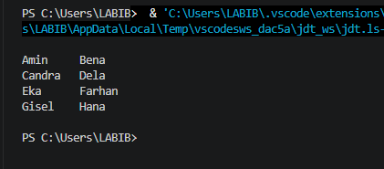
      

* **Pertanyaan 4:** Tambahkan kode berikut setelah langkah 4. Jelaskan fungsi dari penonton.length dan
penonton[0].length!
   *  1 System.out.println(penonton.length);
   *  2 System.out.println(penonton[0].length);
   *  3 System.out.println(penonton[1].length);
   *  4 System.out.println(penonton[2].length);
   *  5 System.out.println(penonton[3].length);

* **Jawab:**
      `penonton.length` berfungsi untuk mengetahui jumlah baris pada array 2 dimensi, sedangkan `penonton[0].length` berfungsi untuk
      mengetahui jumlah kolom pada baris pertama (indeks ke-0).
* **Setelah Modifikasi**
```java

public class Bioskop {

    public static void main(String[] args) {
        
        String[][] penonton = new String[4][2];

        penonton[0][0] = "Amin";
        penonton[0][1] = "Bena";
        penonton[1][0] = "Candra";
        penonton[1][1] = "Dela";
        penonton[2][0] = "Eka";
        penonton[2][1] = "Farhan";
        penonton[3][0] = "Gisel";
        

        System.out.println();
        System.out.printf("%s \t %s\n", penonton[0][0], penonton[0][1]);
        System.out.printf("%s \t %s\n", penonton[1][0], penonton[1][1]);
        System.out.printf("%s \t %s\n", penonton[2][0], penonton[2][1]);
        System.out.printf("%s \t %s\n", penonton[3][0], penonton[3][1]);
        System.out.println();

        System.out.println("Jumlah Baris: " +penonton.length);
        System.out.println("Jumlah Kolom ke 1: " + penonton[0].length);
        System.out.println("Jumlah Kolom ke 2: " +penonton[1].length);
        System.out.println("Jumlah Kolom ke 3: " +penonton[2].length);
        System.out.println("Jumlah Kolom ke 4: " +penonton[3].length);

    }
}

```
* **Pertanyaan 5:** Apakah penonton[0].length, penonton[1].length, penonton[2].length, dan
penonton[3].length memiliki nilai yang sama? Mengapa?
    * **Jawab:** Ya, keempatnya memiliki nilai yang sama, yaitu 2.
Hal ini terjadi karena pada baris deklarasi `String[][] penonton = new String;`, ukuran array langsung ditentukan dalam bentuk matriks
beraturan (persegi panjang) dengan 4 baris dan 2 kolom.

* **Pertanyaan 6:** Modifikasi kode pada pertanyaan 4 untuk menampilkan panjang setiap baris
menggunakan for loop. Compile, run, lalu amati hasilnya.
   *  1 System.out.println(penonton.length);
   *  2 for (int i = 0; i < penonton.length; i++) {
   *  3 System.out.println("Panjang baris ke-" + (i + 1) + ": " +
   penonton[i].length);

#### Hasil Running / Screenshot Output
Berikut adalah contoh tampilan *output* setelah program dijalankan:
      
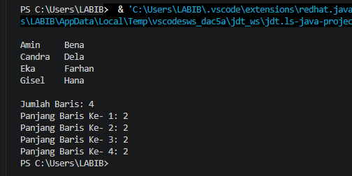

* **Pertanyaan 7:** Modifikasi kode pada pertanyaan 5 untuk menampilkan panjang setiap baris
menggunakan foreach loop. Compile, run, lalu amati hasilnya.
   *  1 System.out.println(penonton.length);
   *  2 for (String[] barisPenonton : penonton) {
   *  3 System.out.println("Panjang baris: " + barisPenonton.length):

#### Hasil Running / Screenshot Output
Berikut adalah contoh tampilan *output* setelah program dijalankan:
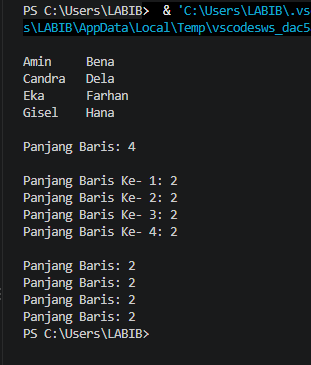
 
* **Pertanyaan 8:** Tambahkan kode untuk menampilkan nama penonton pada baris ke-3 (indeks 2)
menggunakan for loop. Compile, run, lalu amati hasilnya.
   *  1 System.out.println("Penonton pada baris ke-3: ");
   *  2 for (int i = 0; i < penonton[2].length; i++) {
   *  3 System.out.println(penonton[2][i]);

#### Hasil Running / Screenshot Output
Berikut adalah contoh tampilan *output* setelah program dijalankan:

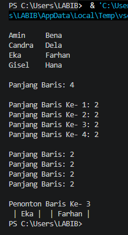
  
* **Pertanyaan 9:** Modifikasi kode pada pertanyaan 8 menjadi perulangan dengan foreach loop. Compile,
run, lalu amati hasilnya.
   *  1 System.out.println("Penonton pada baris ke-3: ");
   *  2 for (String i : penonton[2]) {
   *  3 System.out.println(i);

#### Hasil Running / Screenshot Output
Berikut adalah contoh tampilan *output* setelah program dijalankan:

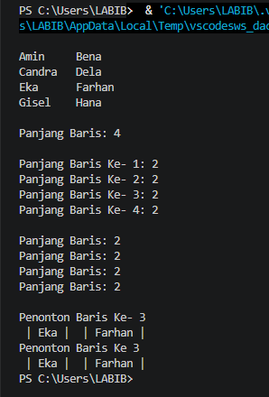
  
* **Pertanyaan 10:** Modifikasi kode pada pertanyaan 9 untuk menampilkan nama penonton setiap baris.
Gunakan String.join(), compile, run, lalu amati hasilnya.
   *  1 for (int i = 0; i < penonton.length; i++) {
   *  2 System.out.println("Penonton pada baris ke-" + (i + 1) + ": " + 
   *  3 String.join(", ", penonton[i]));

#### Hasil Running / Screenshot Output
Berikut adalah contoh tampilan *output* setelah program dijalankan:

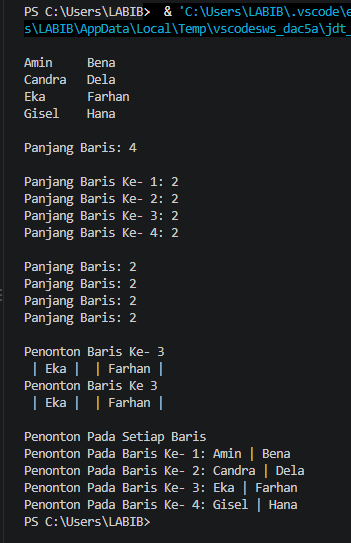 

* **Pertanyaan 11:** Menurut Anda, apa kekurangan dan kelebihan foreach loop dibandingkan for loop?
    * **Jawab:** `foreach loop` jauh lebih ringkas dan aman dari error indeks saat hanya ingin membaca seluruh isi array, sedangkan `for
      loop` jauh lebih fleksibel karena memiliki akses ke nomor indeks dan kontrol penuh atas alur perulangan.
 
* **Pertanyaan 12:** Berapa indeks baris maksimal untuk array penonton? Dari mana nilai itu diperoleh?
    * **Jawab:** Indeks baris maksimal untuk array penonton adalah 3.
    Nilai tersebut diperoleh dari deklarasi Array Pertama yang mempunyai `[4] [2]` yang mengisyaratkan mempunyai 4 baris, karena
    penomoran indeks array di Java selalu dimulai dari 0.
 
* **Pertanyaan 13:** Berapa indeks kolom maksimal untuk array penonton? Apakah nilainya sama untuk setiap
baris?
    * **Jawab:** Indeks kolom maksimal untuk array penonton pada kode tersebut tetap 1, dan nilainya sama untuk setiap baris.
 
* **Pertanyaan 14:** Apa fungsi dari String.join()? Jelaskan parameter yang diterimanya.
    * **Jawab:** String.join() berfungsi untuk menggabungkan beberapa elemen teks (seperti isi array atau kumpulan String) menjadi satu
      buah teks (String) utuh dengan karakter pemisah tertentu di antara setiap elemennya.


### Percobaan 2: Scanner dan Perulangan untuk Input dan Output Array 2 Dimensi

#### Kode Program Java
```java

import java.util.Scanner;

public class Bioskop_With_Scanner_02 {

    public static void main(String[] args) {
        Scanner sc = new Scanner(System.in);
        int baris, kolom;
        String nama, pilihan;
        String[][] penonton = new String[4][2];

        while (true) {
            System.out.print("Masukkan Nama: ");
            nama = sc.nextLine();
            System.out.print("Masukkan Baris (1 - 4): ");
            baris = sc.nextInt();
            System.out.print("Masukkan Kolom (1 - 2): ");
            kolom = sc.nextInt();
            sc.nextLine();

            penonton[baris - 1][kolom - 1] = nama;

            System.out.print("Input penonton lainnya? (y/n): ");
            pilihan = sc.nextLine();

            if (pilihan.equalsIgnoreCase("n")) {
                break;
            }
        }

            System.out.println();
            System.out.printf("%s \t %s\n", penonton[0][0], penonton[0][1]);
            System.out.printf("%s \t %s\n", penonton[1][0], penonton[1][1]);
            System.out.printf("%s \t %s\n", penonton[2][0], penonton[2][1]);
            System.out.printf("%s \t %s\n", penonton[3][0], penonton[3][1]);
            System.out.println();
    }
}

```

#### Hasil Running / Screenshot Output
Berikut adalah contoh tampilan *output* setelah program dijalankan:

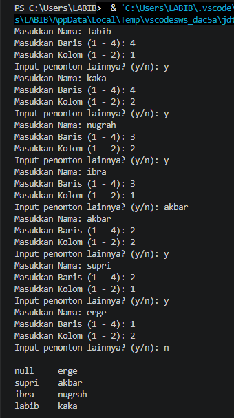

* **Pertanyaan 1:** Apakah pengisian elemen array dari Scanner harus dilakukan secara berurutan mulai dari
indeks ke-0? Jelaskan!
    * **Jawab:** Tidak, pengisian elemen array menggunakan Scanner tidak harus dilakukan secara berurutan mulai dari indeks ke-0.
    Pada kode Bioskop_With_Scanner_02, pengguna bebas memasukkan nomor baris (1 - 4) dan nomor kolom (1 - 2) secara acak sesuai keinginan,
    misalnya langsung mengisi baris ke-3 kolom ke-2 terlebih dahulu.

* **Pertanyaan 2:** Modifikasi program agar menampilkan menu berikut:
   *  1 Input data penonton
   *  2 Tampilkan daftar penonton
   *  3 Exit

* **Setelah Modifikasi**
```java

import java.util.Scanner;

public class Bioskop_With_Scanner_02 {

    public static void main(String[] args) {
        Scanner sc = new Scanner(System.in);
        int baris, kolom, menu;
        String nama, pilihan;
        String[][] penonton = new String[4][2];

        while (true) {
            System.out.println("\n--- MENU BIOSKOP ---");
            System.out.println("1. Input data penonton");
            System.out.println("2. Tampilkan daftar penonton");
            System.out.println("3. Exit");
            System.out.print("Pilih menu (1-3): ");
            menu = sc.nextInt();
            sc.nextLine();

            switch (menu) {
                case 1:
                    while (true) {
                        System.out.print("Masukkan Nama: ");
                        nama = sc.nextLine();


                        while (true) {
                            while (true) {
                                System.out.print("Masukkan Baris (1 - 4): ");
                                baris = sc.nextInt();
                                if (baris >= 1 && baris <= penonton.length) {
                                    break;
                                }
                                System.out.println("Nomor baris tidak tersedia! Harap masukkan baris 1 - 4.");
                                System.out.println();
                            }
                            
                            while (true) {
                                System.out.print("Masukkan Kolom (1 - 2): ");
                                kolom = sc.nextInt();
                                if (kolom >= 1 && kolom <= penonton[0].length) {
                                    break;
                                }
                                System.out.println("Nomor kolom tidak tersedia! Harap masukkan kolom 1 - 2.");
                                System.out.println();
                            }
                            sc.nextLine();

                            if (penonton[baris - 1][kolom - 1] != null) {
                                System.out.println("Peringatan: Kursi sudah terisi oleh " + penonton[baris - 1][kolom - 1] + "!");
                                System.out.println("Silakan masukkan ulang nomor baris dan kolom.");
                                System.out.println();
                            } else {
                                break;
                            }
                        }    

                            penonton[baris -1][kolom - 1] = nama;
                            System.out.println("Data Penonton Berhasil Disimpan");
                            System.out.println();

                            System.out.print("Apakah Ingin Input Penonton Lainnya: (y/n) ");
                            pilihan = sc.nextLine();
                            System.out.println();

                            if (pilihan.equalsIgnoreCase("n")) {
                                break;
                            }
                    }
                    break;
                       
                
                case 2:
                    System.out.println("\n--- DAFTAR PENONTON ---");
                    for (int i = 0; i < penonton.length; i++) {
                        System.out.println();
                        System.out.println("Baris Ke- " + (i + 1) + ": ");
                        for (int j = 0; j < penonton[i].length; j++) {
                            String tampil = (penonton[i][j] == null) ? "***" : penonton[i][j];
                            System.out.print(tampil + "\t");
                        }
                        System.out.println();
                    }
                    break;

                case 3:
                    System.out.println();
                    System.out.println("--- TERIMA KASIH PROGRAM SELESAI ---");
                    sc.close();
                    return;    
                default:
                    System.out.println("\n--- MENU TIDAK VALID. SILAHKAN PILIH ANGKA 1, 2, 3. TERIMA KASIH ---");
                    break;
            }
        }
    }
}

```

* **Pertanyaan 3:** Modifikasi program untuk menangani nomor baris atau kolom yang tidak tersedia
(misalnya baris 7 atau kolom 0).

Berikut adalah contoh tampilan *output* setelah program dijalankan:

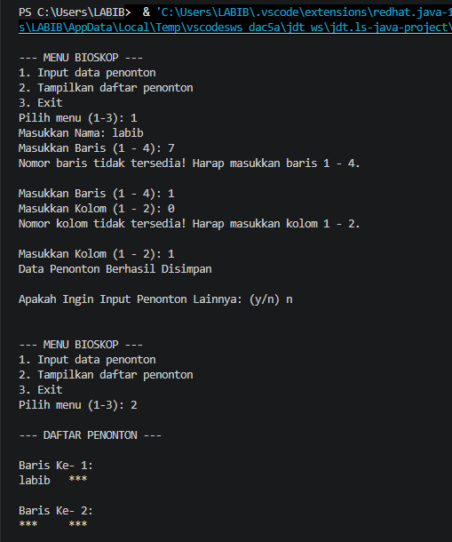

* **Pertanyaan 4:** Pada menu 1, tampilkan peringatan jika kursi yang dipilih sudah terisi penonton lain, lalu
minta baris dan kolom kembali.

Berikut adalah contoh tampilan *output* setelah program dijalankan:

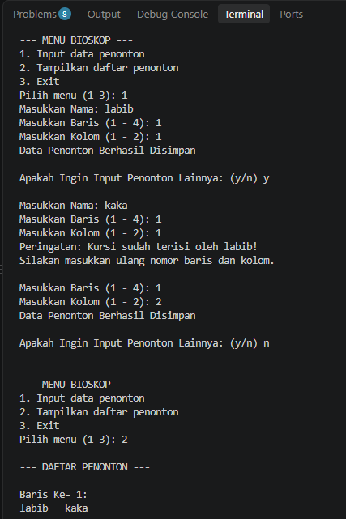

* **Pertanyaan 5:** Pada menu 2, jika sebuah kursi kosong (null), tampilkan *** sebagai pengganti null.

Berikut adalah contoh tampilan *output* setelah program dijalankan:

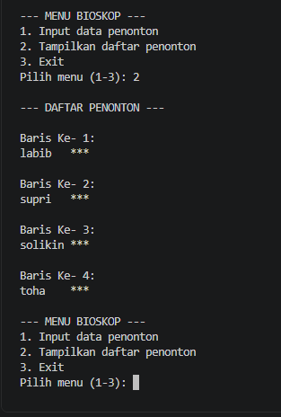


### Percobaan 3: Array 2 Dimensi dengan Panjang Baris Berbeda

#### Kode Program Java
```java

import java.util.Arrays;
import java.util.Scanner;

public class MyNumbers {

    public static void main(String[] args) {

    int[][] myNumbers = new int[3][];
    myNumbers[0] = new int[5];
    myNumbers[1] = new int[3];
    myNumbers[2] = new int[1];

        

        for (int i = 0; i < myNumbers.length; i++) {
            System.out.println(Arrays.toString(myNumbers[i]));
        }   
    }
}

```

#### Hasil Running / Screenshot Output
Berikut adalah contoh tampilan *output* setelah program dijalankan:

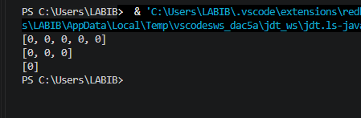

* **Pertanyaan 1:**  Apa fungsi dari Arrays.toString()?
    * **Jawab:** Arrays.toString() berfungsi untuk mengubah seluruh isi elemen sebuah array 1 dimensi menjadi satu representasi teks
      (String) yang rapi dan mudah dibaca di layar.

* **Pertanyaan 2:** Pada Kode 16, Arrays.toString() dipanggil pada myNumbers[i]. Ganti pemanggilannya
menjadi Arrays.toString(myNumbers), lalu compile dan jalankan. Apa yang tampil?
Jelaskan.
* **Jawab:**
Berikut adalah contoh tampilan *output* setelah program dijalankan:

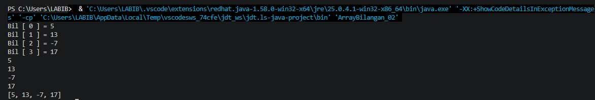

* **Pertanyaan 3:** Jalankan juga System.out.println(Arrays.deepToString(myNumbers));. Bandingkan
hasilnya dengan Kode 16. Mengapa deepToString() diperlukan untuk array 2 dimensi?
* **Jawab:**
Berikut adalah contoh tampilan *output* setelah program dijalankan:


* **Pertanyaan 4:**  Apa nilai default untuk elemen array dengan tipe data int?
    * **Jawab:** Nilai default untuk elemen array dengan tipe data int di Java adalah 0.
 
* **Pertanyaan 5:** Tambahkan kode berikut untuk menampilkan panjang setiap baris. Compile dan run, lalu
amati hasilnya.
   *  1 for (int i = 0; i < myNumbers.length; i++) {
   *  2 System.out.println("Panjang baris ke-" + (i + 1) + ": " +
   *  3 myNumbers[i].length);
* **Jawab:**
      Berikut adalah contoh tampilan *output* setelah program dijalankan:
      

* **Pertanyaan 6:**  Array myNumbers memiliki panjang yang berbeda untuk setiap barisnya. Apakah panjang
array dapat dimodifikasi setelah diinstansiasi? Jelaskan.
    * **Jawab:** Tidak, panjang sebuah array di Java bersifat tetap (fixed-size) dan tidak dapat dimodifikasi (ditambah atau dikurangi)
      setelah diinstansiasi.
      Meskipun setiap baris pada myNumbers memiliki panjang yang berbeda-beda (baris ke-0 panjangnya 5, baris ke-1 panjangnya 3, dan baris
      ke-2 panjangnya 1), ukuran masing-masing baris tersebut sudah dikunci begitu kata kunci new int[...] dijalankan
 
* **Pertanyaan 7:** Jalankan myNumbers[0] = new int[7]; setelah instansiasi, lalu cetak myNumbers.length dan
myNumbers[0].length. Bagian mana yang berubah? Mengapa?
   *  1 for (int i = 0; i < myNumbers.length; i++) {
   *  2 System.out.println("Panjang baris ke-" + (i + 1) + ": " +
   *  3 myNumbers[i].length);
* **Jawab:** Bagian yang berubah adalah nilai myNumbers.length yang bertambah dari 5 menjadi 7, sedangkan myNumbers.length tetap 3 (tidak
      berubah).
      Berikut adalah contoh tampilan *output* setelah program dijalankan:
      

### Percobaan 4: Studi Kasus SIAKAD

#### Kode Program Java
```java

import java.util.Scanner;

public class Siakad_02 {

    public static void main(String[] args) {
        Scanner sc = new Scanner(System.in);

        int[][] nilai = new int[4][3];

        for (int i = 0; i < nilai.length; i++) {
            System.out.println();
            System.out.print("Input nilai mahasiswa ke- " + (i + 1) + ": ");
            double totalPerSiswa = 0;

            System.out.println();
            for (int j = 0; j < nilai[i].length; j++) {
                System.out.print("Nilai mata kuliah ke- " + (j + 1) + ": ");
                nilai[i][j] = sc.nextInt();
                totalPerSiswa += nilai[i][j];
            }

            System.out.println("Nilai rata - rata: " + totalPerSiswa / nilai[i].length);
        }

        System.out.println();
        System.out.println("=====================");
        System.out.println("Rata - rata nilai setiap mata kuliah: ");

        for (int j = 0; j < 3; j++) {
            double totalPerMatkul = 0;

            for (int i = 0; i < nilai.length; i++) {
                totalPerMatkul += nilai[i][j];
            }

            System.out.println("Mata kuliah " + (j + 1) + ": " + totalPerMatkul / nilai.length);
        }
    }
}

```

#### Hasil Running / Screenshot Output
Berikut adalah contoh tampilan *output* setelah program dijalankan:

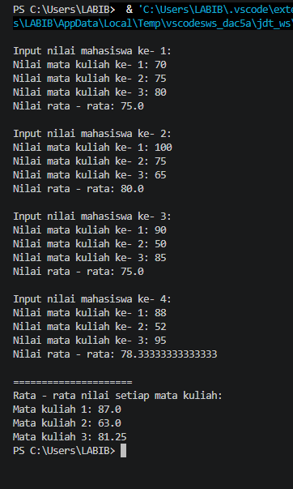

* **Pertanyaan 1:** Bagaimana jika jumlah mahasiswa dan jumlah mata kuliah berubah? Modifikasi program
SIAKAD agar jumlah mahasiswa dan mata kuliah dapat ditentukan saat program berjalan.

* **Setelah Modifikasi**
```java

import java.util.Scanner;
import  java.util.Arrays;

public class ArrayBilangan_02 {

    public static void main(String[] args) {
        
        int[] bil = {5, 13, -7, 17};

        for (int i = 0; i < bil.length; i++) {
            System.out.println("Bil [ " + i + " ] = " + bil[i] + " | Double = " + (bil[i] * 2));
        } 

        for (int nilai : bil) {
            System.out.println(nilai);
        }

        System.out.println(Arrays.toString(bil));
    }
}

```

Berikut adalah contoh tampilan *output* setelah program dijalankan:


### Tugas Mandiri


* **TUGAS** Implementasikan flowchart latihan survei pada slide Dasar Pemrograman (Teori) ke dalam
program Java. Data survei terdiri dari 10 responden dan 6 pertanyaan dengan jawaban 1 sampai 5. Program harus:
   *  1 menyimpan hasil survei ke dalam array 2 dimensi;
   *  2 menampilkan nilai rata-rata untuk setiap responden;
   *  3 menampilkan nilai rata-rata untuk setiap pertanyaan;
   *  4 menampilkan nilai rata-rata secara keseluruhan.

#### Kode Program Java
```java

import java.util.Scanner;

public class Tugas_Mandiri_02 {

    public static void main(String[] args) {
        Scanner sc = new Scanner(System.in);

        int[][] survei = new int[10][6];
        
        double[] rataPertanyaan = new double[6];
        int[] totalPertanyaan = new int[6];
        double[] rataResponden = new double[10];
        int totalResponden;
        int total = 0;
        double rataTotal = 0;

        System.out.println("--- Hasil Survei ---");
        for (int i = 0; i < survei.length; i++) {
            System.out.println("Survei Responden ke- " + (i + 1) + ": ");
            totalResponden = 0;
            for (int j = 0; j < survei[i].length; j++) {
                do {
                    System.out.print("Masukkan nilai (1 - 5) dari pertanyaan ke- " + (j + 1) + ": ");
                    survei[i][j] = sc.nextInt();
                    if (survei[i][j] < 1 || survei[i][j] > 5) {
                        System.out.println("Input Tidak Valid. Ulang Input Nilai");
                    }
                }while (survei[i][j] < 1 || survei[i][j] > 5);
                totalResponden += survei[i][j];
                total += survei[i][j];
                totalPertanyaan[j] += survei[i][j];
                rataPertanyaan[j] = (double)totalPertanyaan[j] / survei.length;
            }
            rataResponden[i] = (double) totalResponden / survei[i].length;
            rataTotal = (double) total / (survei.length*survei[i].length);
        }

        System.out.println();
        for (int i = 0; i < survei.length;i++) {
            System.out.printf("Rata - rata dari responden ke- " + (i + 1) + ": %.2f", rataResponden[i]);
            System.out.println();
        }

        System.out.println();

        for (int i = 0; i < survei[i].length;i++) {
            System.out.printf("Rata - rata dari pertanyaan ke- " + (i + 1) + ": %.2f", rataPertanyaan[i]);
            System.out.println();
        }

        System.out.printf("Rata - rata dari total seluruh nilai dari tiap pertanyaan %.2f\n", rataTotal);
        sc.close();
    }
}

```

#### Hasil Running / Screenshot Output
Berikut adalah contoh tampilan *output* setelah program dijalankan:

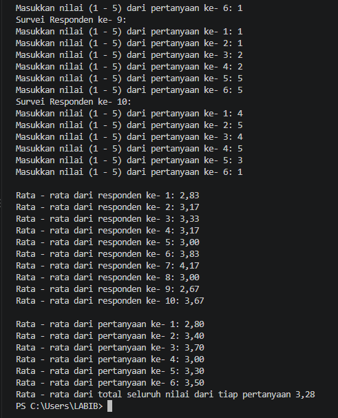

#### KESIMPULAN

Array 2 dimensi dalam Java digunakan untuk menyimpan dan mengolah data dalam bentuk baris dan kolom. Melalui percobaan ini, mahasiswa mempelajari cara mendeklarasikan, menginisialisasi, mengakses, serta mengisi elemen array menggunakan perulangan `for` dan `foreach`. Selain itu, mahasiswa juga memahami penggunaan `Scanner` untuk input data, *jagged array* untuk membuat baris dengan panjang berbeda, serta nested loop untuk menghitung rata-rata nilai setiap mahasiswa dan mata kuliah. Dengan demikian, praktikum ini membantu meningkatkan pemahaman dan kemampuan dalam mengolah data yang memiliki struktur lebih kompleks menggunakan bahasa pemrograman Java.
